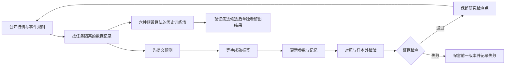

# 哥白尼：递归学习、算法训练场与事件预测研究

2026-10-15。本批直接构建于本地仓库，无需ZIP。已经运行新的币安连续实验和Polymarket公开数据采集。**盈利模式尚未成立，账户净利润未核验。**

## 从小说实验得到的具体要求

小说第41章（PDF 267—271页，关键段在269页）描述了团队创造超过七千种学习算法变体，放入分层测试环境，在知识发现任务中逐关筛选；它没有提供可复现代码、训练数据、损失函数或交易利润证据。

这使工程目标更具体：除了更新权重，还需要候选算法、固定测试协议、未见数据、淘汰记录和可恢复版本。我们采用其中可检验的实验思想，不把叙事中的意识、量子生命或无法关闭等情节当作能力验收。

本轮补读了第15、24、41章，并核对第29章相关段落。15章强调模式检查与修正；24章涉及学习算法重构和目标变更；41章提供训练场及分层筛选的核心比喻。此前已核对8—9章的诞生机制、119章相关段落及尾声。全文966页已经提取、147章已经索引，**尚未逐页精读全书，不能宣称已吃透所有内容**。章节阅读状态见`reports/copernicus_reading_ledger_20261015.json`。

## 盈利模式需要什么证据

系统必须先找到相对于市场价格有信息增量的预测，再判断优势是否覆盖费用、价差、滑点、资金费、结算及运行成本，最后检验它在不同时间和市场状态下是否仍然存在。提高预测准确率、扩大训练量、自动签名下单，任何一项单独成立都不足以证明净利润为正。

对一份最终支付0或1的二元合约，假设真实胜率为p，买入并持有至正常结算的每份期望收益是`p - 全部买入及结算成本`。困难在于p必须经过独立检验；把市场价格当成自己预测，再宣称发现了价差，会形成循环论证。

“稳定”也不是每次、每天或所有市场都获利。本项目尚无足够证据估计长期净期望与回撤，更没有1000美元利润或从1000扩展至9亿美元的容量证明。

## 已实现的三层成长机制



1. **参数层**：原订单簿模型等待五秒成熟报价后更新权重与记忆；遇到缺口丢弃未成熟标签。模型状态可跨会话继承。
2. **实验层**：`cqwe/learning_cycle.py`在新采集前固定源码摘要与实验上下文，逐轮采集、回放、核验并保存不可覆盖记录。十项证据检查失败时不接纳该轮模型。运行时长、轮数、队列与写盘均有上限。
3. **候选层**：`cqwe/algorithm_gym.py`训练六种预先定义的树突变体，在时间顺序60/20/20数据上训练、选择和检验。这是历史回放；选出的候选需要新的前瞻实验，尚未自动部署到实时策略。

没有实现随意改写源代码、无限扩大候选、访问任意网站或自动提高资金风险。结构搜索还只是六个预设变体；不是小说中的七千次实验，也不是开放式递归超级智能。

十项证据检查分别涉及：记录链、原始深度重建、模型回放、虚拟账本、完整采集、检查点世系、标签成熟顺序、新的非重叠时间段、源码冻结、模型边界与真实账户分离。这些不是十轮全面安全审计，也不是盈利认证。

## 本次币安结果

已实际完成五轮、每轮30秒的新采集，每轮十项证据检查均通过，新增25个成熟预测，累计更新从25变为50。此前两段与本轮合计七段采集，仍只覆盖同一天、很短时段的BTC订单簿。

递归实验汇总位于：`D:\CQWE_DATA\copernican_cycles\first_five_rounds_20261015\summary_000005.json`。系统判定`COLLECT_MORE_EVIDENCE`，缺少至少三天覆盖、足够新标签及正的成本后候选证据。三天/300个标签只是研究样本下限，满足后也只进入人工研究复核，不代表策略有效。

六变体训练场使用七段采集中的47个非平局成熟事件：28训练、9验证、10留出。验证集选择候选0；留出Brier为0.241121，常数0.5基线为0.25，但样本仅10个，不能据此声称预测优势成立。其2个有方向留出信号的平均成本后报价代理为**-13.435110基点**。预测分数略有变化，没有转化成盈利证据。

源报告：`reports/algorithm_gym_20261015.json`。现有虚拟账户仍未发生交易；每个会话的虚拟账户独立，不能把各自的10 USDT相加或伪造为连续资金曲线。

## Polymarket 已经接入什么

`cqwe/polymarket_research.py`通过公开Gamma与CLOB读取市场规则、二元代币映射、双边订单簿、最小份额及所报告的费用参数；使用明确的端点白名单，不使用旧版钱包SDK或私钥。

`cqwe/event_learning.py`把事件概率预测写入追加记录，并按事件类别隔离模型。首次模型预测等于市场参考概率，没有凭空构造优势。事件结束日期、最新成交价或接近1的市场价格都不会被当作真值；只有之后获取的关闭市场响应明确给出唯一二元胜出结果，才会记录公共API标签、计算Brier/对数损失并更新参数。该标签还不等同于独立核验的链上终局证明。

本次首批发现中只有一个事件通过当前严格二元、非负风险类型筛选，已记录一条待结算预测；它尚未结算，因此事件学习更新次数是0、评分为null。不能把币安50次五秒方向学习写成50个Polymarket事件样本。

该事件的5份完整二元份额报价，在使用市场所报费用估计后总成本为5.01609报价单位，假设正常兑付5单位，差额为**-0.01609**。两本订单簿非原子获取，实际成交、资金币种和结算费用均未验证，不能当作可执行套利。

当前发现只读取首批20条记录，未穷尽所有市场，未接入独立新闻、气象、链上或官方统计预测特征。事件模块是市场参考概率的残差学习研究，**尚不是已经具备独立信息优势的事件预测模型**。没有真实钱包管理或交易、授权、赎回操作。

## 免费开源实现核查

已核查一个有限的一手来源集合，不声称遍历全球所有脚本，也没有认证任何第三方的稳定盈利：

| 来源 | 核查结果与可借鉴内容 |
|---|---|
| [Polymarket/py-sdk](https://github.com/Polymarket/py-sdk) | 当前官方统一SDK，MIT；接口能力不构成盈利记录。本批直接用公开HTTP，未安装或执行其账户功能。 |
| [Polymarket/py-clob-client](https://github.com/Polymarket/py-clob-client) | 已归档，官方明确提示不再适合新旧集成并要求迁移，不能照旧教程直接采用。 |
| [Polymarket/agents](https://github.com/Polymarket/agents) | 已归档的自主代理框架；能自动交易的介绍没有替代成交、费用和资金流审计。 |
| [Freqtrade/FreqAI](https://raw.githubusercontent.com/freqtrade/freqtrade/develop/freqtrade/freqai/freqai_interface.py) | 已查看滑动训练/回测窗口、持续训练初始化与保存历史预测的代码；关注时间隔离与可追溯性，未复制其代码或宣称复现收益。项目GPL-3.0。 |
| [Hummingbot](https://raw.githubusercontent.com/hummingbot/hummingbot/master/hummingbot/strategy/avellaneda_market_making/avellaneda_market_making.pyx) | 已查看库存偏离、报价/数量调整和费用加入报价的代码；这些需要实际库存、波动率与交易强度，不等于看到大挂单即可获利。项目Apache-2.0。 |

机器可读清单见`reports/open_source_inventory_20261015.json`。GitHub未认证API在查询提交版本时触发限流，未规避限制，也没有虚构固定提交号。上述源码链接指向可变分支，不构成本地安装包的版本锁定或依赖安全审计。

手续费参考：[Polymarket费用文档](https://docs.polymarket.com/trading/fees)。结算参考：[事件结算文档](https://docs.polymarket.com/concepts/resolution)。实际规则与API响应可能变化，运行时须重新核查。

## 验证与继续运行

本轮新增30项检查，加上相关的原订单簿与V85测试，共50项通过。测试覆盖重复标签、类别隔离、模型继承、回退、并发锁、源码变更、留出泄漏、费用与深度，以及记录回放。上轮全仓601项测试通过；本轮没有把它改写成未经执行的631项全仓通过。

```powershell
Set-Location 'D:\CQWE\alpha-hunter'
& 'C:\Python314\python.exe' -m unittest tests.test_event_learning tests.test_learning_cycle tests.test_algorithm_gym tests.test_tidal_hunter tests.test_v81_v85 -v

# 在同一冻结版本与实验目录下继续五轮，自动继承上一轮接受的模型。
& 'C:\Python314\python.exe' -m cqwe.learning_cycle --root 'D:\CQWE_DATA\copernican_cycles\first_five_rounds_20261015' --rounds 5 --seconds 30

# 获取公开事件观察；之后单独检查已有预测是否获得最终二元标签。
& 'C:\Python314\python.exe' -m cqwe.polymarket_research --limit 3
& 'C:\Python314\python.exe' -m cqwe.polymarket_research --settle
```

若更改源码、每轮时长或市场，应建立新的实验目录，不能悄悄改写旧实验条件。进程结束后不会自行重启；本批没有安装后台服务、定时任务或30天无人值守任务。

## 尚未完成的验收

- 全书逐页精读；阅读台账保留明确的未读状态。
- 跨日期、跨市场状态的前瞻预测与独立复验；历史选优结果尚未升级为实时赢家。
- 独立事件信息模型及充足的已结算事件数据。
- 账户级成交、费用、资金费、入出金与未平仓资产对账。
- 足够可信的净期望、回撤与资金容量证据。

当前交付是能够继续学习、比较和拒绝失败候选的研究基础。盈利目标没有被标记为完成。
