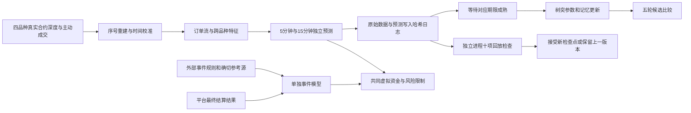

# 哥白尼四品种：合约与定时涨跌预测

2026-10-15。本版本是可运行的**真实公开行情研究与统一资金模拟系统**，覆盖BTCUSDT、ETHUSDT、SOLUSDT、BNBUSDT，默认预测300秒和900秒。没有真实订单发送器、账户托管或已证明的盈利模式。

## 一次启动

```powershell
cd D:\CQWE\alpha-hunter
.\RUN_COPERNICAN_FOUR_MARKET.ps1
```

默认运行5轮，每轮300秒，连续行情不在轮间断开；回放审计在独立进程执行。实际时间还包括连接、快照和审计。进程有明确预算并会退出，不会安装开机启动、定时任务或无限循环。依赖为Python和`requirements-tidal.txt`中的`websocket-client`；模型和统计不依赖付费AI接口。

更长的有限实验：

```powershell
C:\Python314\python.exe -u -m cqwe.four_market_supervisor --root D:/CQWE_DATA/copernican_four_market --rounds 20 --seconds 300 --horizons 300,900 --attempts 3
```

同一supervisor目录允许增加目标总轮数；更改代码、期限或每轮时长须使用新目录。同一轮不覆盖重跑。默认最多3次恢复尝试，耗尽后停止并保留失败材料。意外强制杀进程留下的锁不会自动删除，须先确认进程已结束；脚本不会猜测锁已失效。

单独复核某轮：

```powershell
C:\Python314\python.exe -m cqwe.four_market_runner --replay D:/CQWE_DATA/copernican_four_market/attempt_0001/round_000001
```

## 数据与学习路径



每个品种、每个期限各自维护二树突分支、四树突分支、线性、冻结模型及均值回归对照。所有预测先写入持久日志，成熟标签出现后才更新。滚动预测彼此不重叠：一个期限的一份预测尚未成熟，就不重复创建同期限样本。

输入包含盘口不平衡、最优档订单流不平衡、短窗主动买卖额、短期动量、微价格偏移、价差、价格变化强度和新鲜的BTC上下文。这里的变化强度是短时代理，不是独立估计的长期波动率。BTC上下文失效时置零，不能读取未来其他币种行情。

五轮时只在预声明候选间比较。研究门槛包含至少100个成熟标签、100个方向信号、低于基线的Brier分数及正的成本后代理均值下界。该下界是描述性筛选，未校正候选选择、多重检验或非平稳性；满足它不构成可实盘盈利证明。所谓“进化”是有边界的结构候选替换与持续参数学习，没有自行修改Python代码、重写目标或放宽风险限制。

## 与做市商竞争如何检验

公开聚合订单簿无法可靠识别做市商身份、数量、隐藏订单和真实队列位置。本版研究能观察的结果：盘口压力、价差、订单流、未来价格变化与成本后的方向代理。均值回归模型是竞争对照，不能称为重建了某家做市商的算法。

合约模拟为吃单生命周期，使用可见深度最多10%的逐档VWAP，再叠加假设滑点和手续费；没有把自己挂出的买卖价差计作已经赚取的利润。挂单排队成交、真实手续费等级、资金费率、真实风控拒单及交易所撮合结果尚未接入，因此模拟盈亏仍不是账户收益。

## 同一个10美元资金池

- 全部品种和产品共用10个虚拟USDT；事件模拟只接受明确的USDT抵押标记，其他抵押币直接拒绝。Polymarket若使用不同抵押币，还需单独账户与换汇核算，不能按1比1混入。
- 单品种名义敞口上限为当前虚拟权益25%，总敞口上限50%；挂起的合约意图也占额度。预测份额已付成本同样纳入敞口。
- 合约按250毫秒延迟意图模拟建仓，重新检查最小数量、最小名义金额、深度、资金和滑点；不能用虚拟杠杆绕过交易所最小单限制。
- 止损、止盈、时间退出和回撤停止均有记录。断线取消未成交意图，已有模拟仓位保留并等新鲜行情尝试退出，不能在缺失行情时伪造平仓。
- 二元份额保守估值为零直至明确结算。极端跳空仍可能越过止损；这些上限不保证实际损失被限制在某个数额。

实际交易规则由币安公开exchangeInfo获取。若10美元与名义金额下限冲突，拒绝模拟建仓是正确输出。

## 合约预测与平台预测严格区分

自动合约标签使用**接收时间附近的币安永续合约中间价**，是一种研究代理。它不是币安指数价、Chainlink数据或预测市场的最终裁决。掉线、数据不新鲜、到期错过容忍窗口或平价时不伪造二元标签。

`prediction_catalog.py`能抓取四品种5/15分钟Polymarket事件元数据和Up/Down真实盘口。初次真实采集八组均成功，返回规则使用Chainlink的60秒TWAP。目录只在启动时观察一次，并非持续轮换事件交易器。

币安钱包预测市场的官方目录和订单簿API也要求签名GET。本版提供端点白名单的只读接入，环境变量名为`CQWE_PREDICTION_READ_API_KEY`、`CQWE_PREDICTION_READ_API_SECRET`。不配置时明确报告未连接。不得把密钥写进报告、源码或聊天。它不具备下单、转账、提币、授权或交易签名端点。

官方资料：[预测市场行情接口](https://developers.binance.com/en/docs/catalog/web3-wallet-prediction-trading/api/rest-api/market-data)、[币安预测API公告](https://www.binance.com/en/support/announcement/detail/1cfffee40a0d49c182e0b4366ea3f374)、[合约深度流](https://developers.binance.com/en/docs/catalog/core-trading-derivatives-trading-usd-s-m-futures/api/ws-streams/public)。不能把旧的“事件合约只支持App”说明套到钱包预测市场API。

## 外部事件接口已经实现，自动参考源尚未接通

`Engine.event_quote`与`event_resolve`支持单独的事件模型、真实结算后的学习、概率评分、统一资金模拟买入及结算。原始合约代理模型不会被直接拿来宣称平台事件胜率。规范化事件可通过`--event-inbox <目录>`输入；脚本只解析JSON，不执行里面的指令、代码或URL。

报价必须包含：平台/市场/品种、抵押币、起止和观察时间、规则哈希、来源哈希、确切参考源及价格、锚定价、平价规则、八维特征、市场参考概率、两侧卖价及数量、已知费用公式、费率和最小份额。结算必须包含匹配规则哈希、最终状态、来源哈希、观察时间和两侧实际支付比例。仅正常0/1结算训练二元分类；0.5/0.5退款可以结算虚拟持仓，但不伪造涨跌标签。

JSON来源哈希只是溯源校验，不能证明输入就来自官方预言机。**仍缺Chainlink TWAP/锚定价的可信自动采集与规则适配，币安签名行情本次也未取得凭证实测。**因此外部平台自动预测交易闭环尚未完成；当前可以运行四品种合约多期限学习，观察八组平台盘口，并用明确标注的测试输入验证事件流程。测试通过不代表真实平台预测已经交易。

## 自我修复与十项检查

行情连接有次数限制的退避重连；深度序列断裂后重新取快照；过期队列保持序列推进以赶上实时流；缺失数据暂停研究。时间校准使用币安服务器时间及往返延迟估计，再用单调时钟推进。

逐轮检查包括日志哈希链、原始深度重建、特征回放、因果预测、模型状态、共享资金、事件学习、检查点继承、代码版本，以及四品种覆盖与零实盘订单。行情处理与回放审计分进程；检查点按轮次顺序接受，后续通过不能跨过祖先失败轮。

supervisor保存全部失败尝试，从最近完整通过回放的检查点创建新尝试。进程重启后的行情连续性明确失效：丢弃跨停机期未成熟代理标签，保留已学模型和虚拟账户，现有仓位等新行情退出。不是在未知时段补造行情或收益。

## 验证与证据

测试入口：

```powershell
C:\Python314\python.exe -m unittest tests/test_four_market.py tests/test_four_market_supervisor.py
```

覆盖300/900秒标签、币种隔离、模型恢复、资金与延迟建平仓、最小单、断线退出、事件退款/最终标签、未知费用拒绝、篡改和监督恢复。真实前向运行、全量测试及目录快照的最终结果以`reports/four_market_validation_20261015.json`为准；不要从本说明推断尚未完成的运行结果。

当前没有验证稳定正收益、30天1000美元目标或更大资金容量；没有推送GitHub或自动部署实盘。
