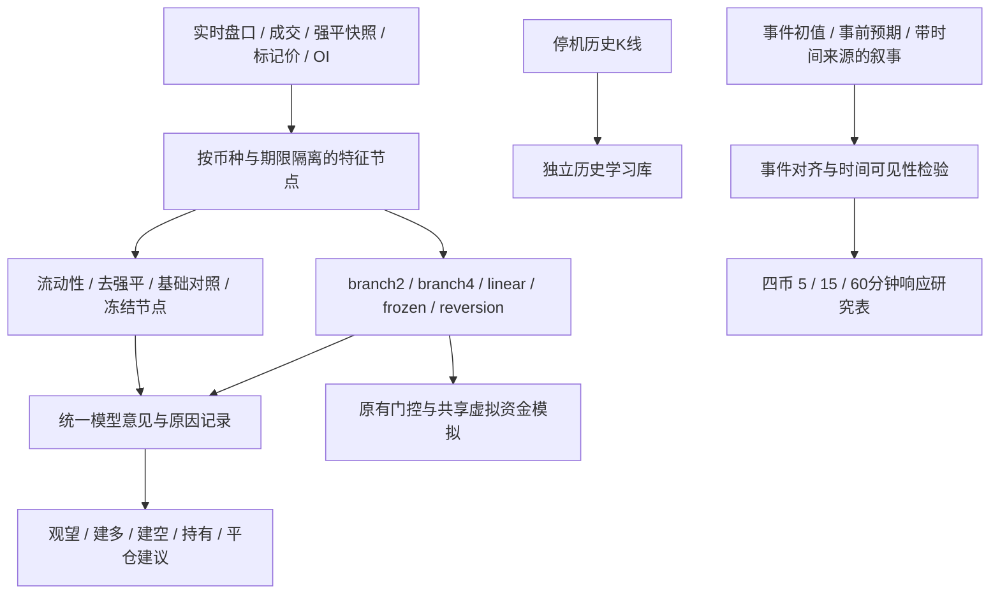

# 本地哥白尼研究运行器 V3

**2026-10-16运行状态更新：常驻研究已停止，登录快捷方式移至备份。** 四个旧定时任务因Windows权限不能直接禁用，已在各自VBS启动器加入可撤销暂停标记检查并验证退出，配置与原启动器均保留。标记文件为`D:\CQWE_DATA\PAUSE_LEGACY_SCHEDULED_RESEARCH.flag`。当前只按需运行单进程、低优先级、限时研究；下面的自动启动说明是操作方式，不代表现在已启用。新事件研究见`reports/event_history_20261016.md`。

用户确定使用本地电脑：关机停止，Windows用户登录后恢复研究；没有连接或改动阿里云及灵犀场服务。当前仅公开行情、历史研究与模拟资金，不涉及账户凭证或实盘订单。

## 启动和停止

```powershell
.\START_COPERNICAN_LOCAL.ps1 -InstallAutostart
.\START_COPERNICAN_LOCAL.ps1 -Stop
```

默认数据目录`D:\CQWE_DATA\copernican_local_v3`。启动项是当前用户Startup目录下的`CQWE Copernican Research.lnk`；不需要管理员。自动启动发生在**Windows用户登录后**，不是关机运行，也不是未登录运行。删除该快捷方式可取消自动启动。

`status.json`提供进程状态、最近接受轮次、历史补课进度和统一模型意见。每轮原始日志、模型及资金检查点存于`sessions`。子进程失败后退避重试，复制最近通过十项回放检查的状态进入新会话；原始失败记录保留。重连不伪造停机期订单簿和交易。

启动器另启一个轻量官方公告观察进程，每五分钟读取固定的Fed、SEC及BLS CPI订阅源并保存原始快照。首次实测Fed20条、SEC25条成功；BLS CPI RSS返回403，明确记为不可用，不绕过访问限制。`official_news/status.json`记录逐源状态，新闻快照上限100MB。它不覆盖全部全球新闻，没有自动生成利多/利空交易指令；同源转载归组、政治社交媒体、战争、ETF资金流、黑客原始披露的专门适配器仍需扩展。

默认回合300秒、每会话12回合，每五轮已有模型对照复核。每五分钟最多补取4页公开5分钟K线，每页最多1000条，四币轮流处理。初始回溯30天，可用CLI配置1—730天；请求预算决定完成所需时间，不宣称一次全部下载。历史权重与实时权重分别保存。历史补课目前是**5分钟K线学习**，不包括完整历史逐笔、订单簿、强平、资金费对账或新闻全量下载。

磁盘证据默认上限4GB，剩余空间低于2GB也会停止；不会自动删除原始证据。因此无法承诺无限期持续运行。达到上限须归档证据并调整预算，或换新研究目录。网络断开会暂停并重试；电脑睡眠时不采集。本版没有改电脑电源策略。

## 多模型结构



统一意见每品种约一秒记录一次九个节点的预测、过去标签数、资格及权重。无过去证据的节点权重为零；流动性节点目前保持影子对照。统一意见属于研究建议，**尚未取代原有模拟开平仓规则**。宏观事件研究目前为独立模块，尚未自动影响实时神经节点或真实账户。概率融合和树突启发式软件不等于人脑或意识。

## 事件确实是样本

`macro_events.py`保存事件组ID，区分初次公布值与修订值、整体与核心口径、月率与年率；事前预期必须在公布前已有来源记录。没有预期不计算“超预期”。文章同时检查发布时间和首次观察时间，文本作为不可信数据，不执行其中指令。样本外评估须按事件组/日期划分，同一次CPI的四币多窗口不能当独立事件。

```powershell
C:\Python314\python.exe -m research.event_response_study --events reports/cpi_20261014_event_input.json --output D:/CQWE_DATA/new_event_study
```

输入为JSON事件数组，至少包含`event_id`、`family`、`scheduled_ms`。实际值/预期可包含`value`、`series`、`unit`、`available_ms`、`first_seen_ms`、`source_sha256`，实际值另外要求`first_release: true`。这只是溯源结构，哈希本身不证明数据来源真实。脚本查询Binance已收盘1分钟K线并保存原始响应，生成事件后5/15/60分钟价格标签，**不是成交收益**，没有扣手续费、滑点和资金费，也不证明因果关系。

2026-10-14 CPI单事件实测表见`D:/CQWE_DATA/cpi_20261014_event_study/report.json`。有12个币种/窗口响应，但独立事件数是1，事前一致预期缺失。自动经济日历、首次发布值、历史一致预期、叙事和跨资产行情的可靠完整源尚待接通；当前不声称已完成宏观预测模型训练。

## 与小说条件对应

本轮重读PDF109—111页（第15章）和269—270页（第41章）：模式观察与修正对应带来源的数据、错误记录和恢复；分层训练场对应预先声明的候选、影子对照与回放检查；持续转变对应可保存的参数更新。全书已经抽取索引，本轮仍未逐页研读966页全部内容。

第41章描述七千多算法变体和多关卡测试，但没有提供可复现的神经算法。当前有限九节点与跨币种多期限模型，不宣称复现小说意识。任意源码自动重写、独立补丁晋级及宏观节点完整闭环尚未实现；当前自动变化的是可学习权重和有限候选选择。数据采集和程序正确性也不能替代盈利证据。

## 版本与验证

V2源码已另存`reports/four_market_v2_source_archive_20261015`（88个Python文件及哈希）。V3改变源码哈希与状态格式，需要新数据目录；旧V2证据要用归档源码核对。V3的全部验证结果以`reports/local_v3_validation_20261015.json`为准。
